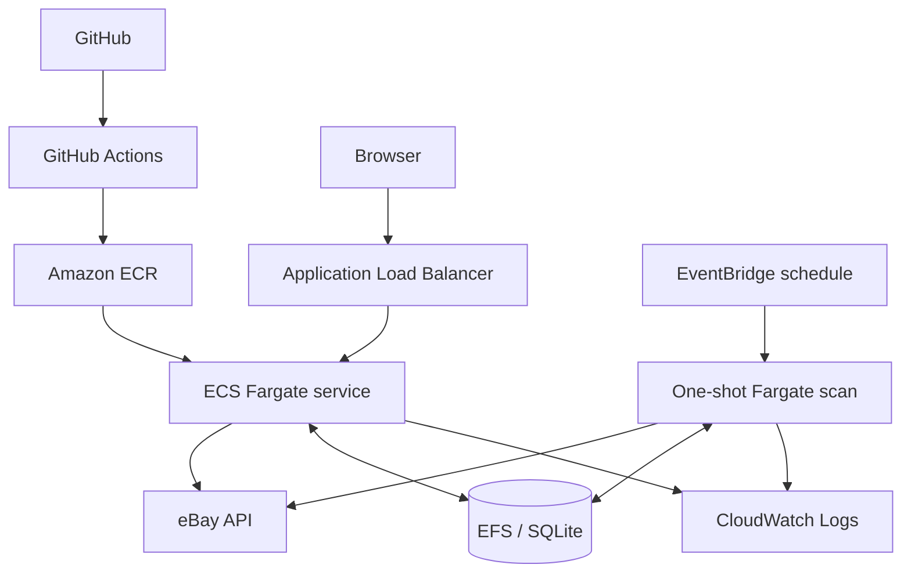

# eBay Arbitrage Analyzer on AWS

A deployment-ready adaptation of [000Janela000/ebay-arbitrage](https://github.com/000Janela000/ebay-arbitrage). The original project finds resale opportunities by comparing eBay auctions with Georgian marketplace prices. This fork preserves that application and adds Docker, AWS infrastructure as code, scheduled execution, persistent storage, and CI/CD.

> **Status:** the Terraform configuration is validated for deployment; this repository does not claim that an AWS environment is currently provisioned.

## Architecture



The React UI and FastAPI API run in one container. A single long-running task supports the UI, while the disabled-by-default schedule can run a scan and exit. Public subnets keep the design simple and avoid NAT gateway cost.

## Technology

Python, FastAPI, React, TypeScript, SQLite, Docker, Terraform, AWS ECS/Fargate, ECR, IAM, EventBridge, EFS, CloudWatch, an Application Load Balancer, and GitHub Actions.

## Local setup

The app can be explored without eBay credentials, although scans require approved API credentials.

```bash
cp .env.example .env

python -m venv .venv
# Windows: .venv\Scripts\activate
# macOS/Linux: source .venv/bin/activate
pip install -r requirements-dev.txt
uvicorn backend.main:app --reload --port 8011
```

In a second terminal:

```bash
cd frontend
npm ci
npm run dev
```

Open `http://localhost:5173`. For a production-style local run:

```bash
docker build -t ebay-arbitrage .
docker run --rm -p 8011:8011 --env-file .env ebay-arbitrage
```

## AWS deployment

Prerequisites: Terraform 1.6+, Docker, AWS CLI, valid AWS credentials, and an image pushed to ECR. Copy `terraform/terraform.tfvars.example` to `terraform/terraform.tfvars` and adjust it; that file is ignored by Git.

Create ECR first, push the image, then apply the complete stack:

```bash
cd terraform
terraform init
terraform apply -target=aws_ecr_repository.app

ECR_REPOSITORY_URL=$(terraform output -raw ecr_repository_url)
ECR_REGISTRY=${ECR_REPOSITORY_URL%%/*}
aws ecr get-login-password --region us-west-2 | docker login --username AWS --password-stdin "$ECR_REGISTRY"
cd ..
docker build -t "$ECR_REPOSITORY_URL:latest" .
docker push "$ECR_REPOSITORY_URL:latest"

cd terraform
terraform plan
terraform apply
```

PowerShell equivalent:

```powershell
Set-Location terraform
terraform init
terraform apply -target=aws_ecr_repository.app

$ECR_REPOSITORY_URL = terraform output -raw ecr_repository_url
$ECR_REGISTRY = $ECR_REPOSITORY_URL.Split('/')[0]
aws ecr get-login-password --region us-west-2 | docker login --username AWS --password-stdin $ECR_REGISTRY
Set-Location ..
docker build -t "${ECR_REPOSITORY_URL}:latest" .
docker push "${ECR_REPOSITORY_URL}:latest"

Set-Location terraform
terraform plan
terraform apply
```

Terraform creates a dedicated VPC, two public subnets, ALB, ECR repository, ECS service/task definition, EFS-backed SQLite storage, CloudWatch logs, and an EventBridge rule. The schedule defaults to `rate(30 minutes)` but remains disabled until `schedule_enabled = true`. Configure categories in the UI before enabling it.

The ALB uses HTTP because custom DNS and TLS are intentionally out of scope. For a personal demo, set `allowed_ingress_cidr` to your public IP in CIDR form rather than leaving it open.

## Credentials and secrets

- **AWS locally:** use an AWS CLI profile, IAM Identity Center, or another standard credential provider. Never place AWS keys in Terraform files.
- **eBay locally:** copy `.env.example` to `.env`; `.env` is ignored. `EBAY_REDIRECT_URI` is available for future OAuth flows but is not currently required by client-credentials API calls.
- **eBay on AWS:** create a Secrets Manager secret containing JSON keys `EBAY_CLIENT_ID`, `EBAY_CLIENT_SECRET`, and `EBAY_REDIRECT_URI`, then set `ebay_credentials_secret_arn`. ECS injects those keys at runtime, and the task execution role can read only that secret.
- **GitHub Actions:** create an AWS OIDC deployment role and an S3 state bucket, then add repository variables `AWS_DEPLOY_ROLE_ARN`, `TF_STATE_BUCKET`, optional `TF_STATE_KEY`, optional `AWS_REGION`, and optional `EBAY_CREDENTIALS_SECRET_ARN`. The deploy workflow is manual (`workflow_dispatch`) and does not deploy on a push.

No secret values belong in GitHub variables, `.env.example`, committed `.tfvars`, or Terraform outputs.

## Validation

```bash
terraform -chdir=terraform fmt -check
terraform -chdir=terraform init -backend=false
terraform -chdir=terraform validate
docker build .
```

Pull requests and pushes that change Terraform run the first three checks automatically.

## Cost and persistence notes

This architecture is intentionally understandable rather than free: the ALB, continuously running Fargate task, EFS, and logs incur charges. Disable scheduled scans until needed. SQLite keeps the application migration small, but constrains the service to one web task; see [architecture notes](docs/architecture-notes.md) for the tradeoff.

## Teardown

```bash
cd terraform
terraform destroy
```

EFS deletion removes the SQLite data. Export anything important first.

## Upstream project and licensing

The application is based on the [eBay Arbitrage repository by 000Janela000](https://github.com/000Janela000/ebay-arbitrage). The work in this fork focuses on containerization, AWS infrastructure, Terraform, CI/CD, environment configuration, and deployment documentation; it does not claim authorship of the upstream arbitrage engine.

The upstream repository did not include a license file when this adaptation was prepared. No license has been added or implied here; contact the upstream author before reuse or redistribution beyond what their repository permits.
